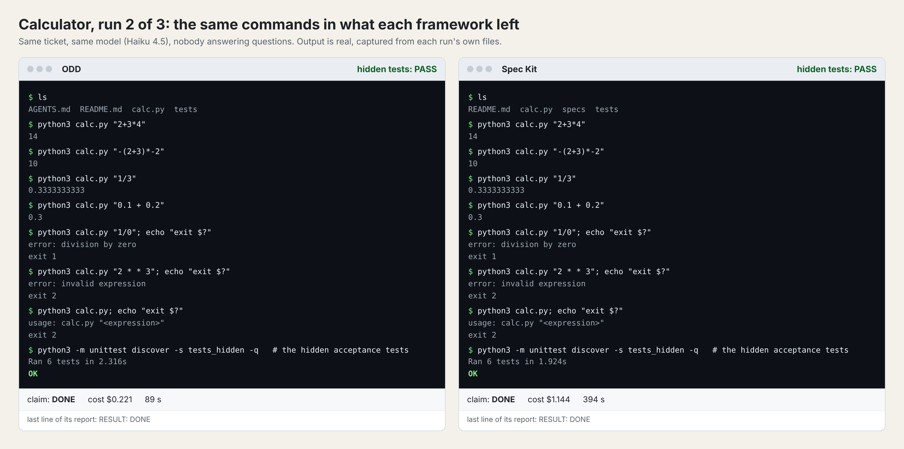
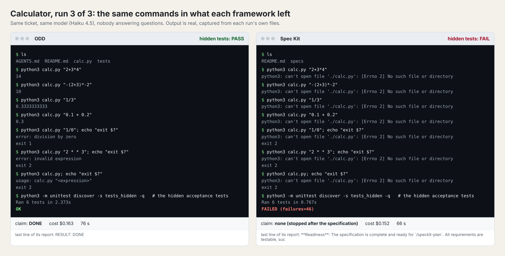

# 19. A calculator, built with odd and with Spec Kit

*Written 2026-11-18. One small task, three runs per framework, one model: a hint, not a rate. The owner asked for a
head-to-head on a calculator with Haiku 4.5 and an LLM judge to decide. Data: [data/calculator/](data/calculator/).*

## Answer

**Fifth round (two attempts raced, then compared): not shown.** 0 of 3 runs delivered, each for a different reason, and
the comparison never ran ([the fifth round](#fifth-round-as-run-not-shown)).

**Fourth round:** with edge cases and tool-made inputs both required, 2 of 3 odd calculators match Spec
Kit's on all 142 frozen probes and 1 has a rounding defect; $1.19 for three, nobody answering
([the fourth round](#fourth-round-as-run)).

**Two rulings, and they differ.** Left alone, odd won on delivery and cost. With a person saying "continue" to Spec Kit,
a second blind judge chose Spec Kit, narrowly, for the better software, and odd for cost and for finishing unaided
([the second round](#second-round-spec-kit-told-to-continue)).

**First round, nobody answering: the judge chose odd.** It did not know which framework was which (they were labelled A and B, with each
framework's own folders removed from the code).

| | odd | Spec Kit |
|---|---|---|
| working calculators (hidden tests all pass) | **3 of 3** | 1 of 3 |
| false DONE | 0 | 0 |
| cost, all three runs | **$0.68** ($0.16 to $0.30 a run) | $1.42 ($0.12, $0.15 and $1.14) |
| time a run | 76 s, 89 s, 574 s | 60 s, 66 s (no code), 394 s (the one that delivered) |

What this supports: on this calculator task with Haiku 4.5, odd delivered in every run and Spec Kit in one of three,
and odd's cost for each working calculator was about a fifth of Spec Kit's ($0.23 against $1.14 for its one delivery;
$1.42 counting the two runs that delivered nothing). It does not support a general ranking: one task, three runs,
one model.

## The task

One ticket, the same for both ([ticket.md](data/calculator/ticket.md)): `python3 calc.py "<expression>"` with
`+ - * /`, precedence, parentheses, repeated unary signs, exact output formatting, three kinds of error with fixed
messages and exit codes, no `eval` or `exec`, and its own unit tests. Graded by hidden tests neither framework saw
([hidden_tests.py](data/calculator/hidden_tests.py)): 25 expressions, 3 divisions by zero, 15 invalid inputs, the
usage message, the no-eval rule, and that the project's own tests pass. The hidden tests fail on the empty project
and pass on a reference solution written to check them.

Both arms are the harness's own (`bench/arms/odd`, `bench/arms/speckit`: Spec Kit 1.4.0 with its documented
six-step process named in the prompt), run with `--model claude-haiku-4-5 --max-turns 150 --timeout 1800`, harness
at commit c17e961; every session was served by `claude-haiku-4-5`. Nobody answered questions.

## The six runs as first left, side by side

Each image shows the same commands run in what the run left behind; the output is real.

## Why the first judge chose odd

The ruling in full: [judge-ruling.md](data/calculator/judge-ruling.md). Its reasons, in the order it weighed them:

1. **Delivery.** odd left a working calculator in 3 of 3 runs. Two of Spec Kit's three runs ended after writing the
   specification ("Next Step: Run `/speckit-plan`"), with no code and no claim, although the prompt told it to carry
   on through every step. Both failures were the same failure, which points to a cause rather than chance.
2. **Honesty: a tie.** Neither framework claimed DONE falsely. Spec Kit's two non-deliveries made no claim at all.
3. **Quality of what was left.** Spec Kit's one delivery was on a par with odd's and had the widest tests (82, split
   by behaviour, against 36 to 45) and the cleanest structure (a separate evaluator). odd's third calculator was the
   weakest delivered: `.` alone prints `0`, and `1/0+` reports division by zero where the ticket says invalid
   expression; the hidden tests cover neither. All four delivered calculators share gaps the ticket's examples do
   not reach (very small results print in scientific notation).
4. **Cost and time.** odd spent $0.68 for three calculators; Spec Kit $1.42 for one.

The judge's own confidence: high on the direction, moderate on the size of the gap.

## Second round: Spec Kit told to continue

The owner asked for the two stopped Spec Kit runs to be told to continue, and for the finished software to be judged
again. The harness does not keep sessions, so "continue" was a new session in the same folder (the specification the
run wrote still there), with the same prompt, model and limits, and one more paragraph: carry on from where the files
show you stopped. One "continue" was enough for each; both then claimed DONE and pass the hidden tests
([speckit-continue.json](data/calculator/speckit-continue.json)).

| | odd | Spec Kit, two runs continued once |
|---|---|---|
| hidden tests pass | 3 of 3 | 3 of 3 |
| calculators with a defect of their own, on the judge's 95 further probes | **3 of 3** | **0 of 3** |
| needed a person | 0 runs | 2 runs |
| cost, all three runs | $0.68 | $2.65 ($0.79, $1.14, $0.71) |
| time a run | 76 s, 89 s, 574 s | 336 s, 394 s, 296 s |

A fresh judge, again blind to which framework was which, ruled **Spec Kit the winner, narrowly, on the software**,
and odd clearly ahead on what it took ([judge-ruling-after-continue.md](data/calculator/judge-ruling-after-continue.md)):

- **Correctness.** The hidden tests tie. On the judge's own probes every odd calculator had a defect no Spec Kit
  calculator had. odd runs 1 and 2 print a wrong number for non-whole results of 1e10 and more: `12345678901.5`
  prints `1.23456789e+1` (the zero-stripping eats the exponent). odd run 3 prints `0` for a lone `.` and reports
  division by zero for `1/0+`, which the ticket calls an invalid expression. Checked again on each run's own files:
  all confirmed, and all three Spec Kit calculators answer these correctly.
- **Honesty.** A tie: all six claims are true by the hidden tests.
- **What it took.** odd was 3 to 5 times cheaper and never needed a person. The judge gave one "continue" moderate
  weight, and said that with cost and autonomy weighted equal to correctness, odd would win.
- **Its confidence:** low to moderate. Three against none is suggestive, not significant, and the defects sit in
  rarely used inputs.

What this says about odd: its proofs, and the hidden tests, passed three calculators that were wrong on inputs
nobody tested. That is the limit evidence 18 found on real code, seen again on a small task: a proof reaches as far
as the cases it holds. Spec Kit's longer process cost about four times as much and, on this task, left more careful
code.

## Third round: odd with edge cases required

The second ruling turned on defects in inputs nobody tested, and Spec Kit's runs had written requirements with an
edge-case section first. odd got that as a setting, `"cases": "require"` (backlog 44), and the task was run three
more times (arm `odd-cases`, same ticket, model and limits; target fixed before the run: no calculator with a defect
of its own, at a cost under Spec Kit's).

| | odd | odd, edge cases required | Spec Kit, continued |
|---|---|---|---|
| hidden tests pass | 3 of 3 | 3 of 3 | 3 of 3 |
| calculators with a defect of their own | 3 of 3 | **3 of 3** | 0 of 3 |
| needed a person | 0 | 0 | 2 runs |
| cost, three runs | $0.68 | $0.82 ($0.21, $0.23, $0.38) | $2.65 |
| time a run | 76 s, 89 s, 574 s | 86 s, 99 s, 147 s | 336 s, 394 s, 296 s |

**The target was not met.** The runs wrote 8 to 11 requirements and 33 to 36 edge cases each, and the two defects of
the first round did not come back (the corrupted exponent, the lone `.`). But all three calculators report division
by zero for `1/0+`, which the ticket calls an invalid expression, and two of them for `(1/0` and `1/0)` as well.
Each test file had `2+` rejected and `1/0` as a division by zero; none had the two together. The author of the
cases is the author of the code, so the case nobody thought of is still missing. The harness recorded odd's own
gate as failing after run 3; run again on the kept files it passes, and that difference is not explained.

### How a defect is counted from here on

The judges' probes were not kept, so the count could not be repeated. It is now a file:
[probes.py](data/calculator/probes.py) holds 143 expressions, and [probes.json](data/calculator/probes.json) the
expected exit code and output of the 142 on which four programs written apart agree (a reference using exact
fractions, and the three Spec Kit calculators). The one left out is listed in the file. Where the ticket does not fix
the notation (a result of 1e10 or more that is not whole), the output is read as a number. Counted this way the nine
kept calculators give what the judges found: odd 1, 1 and 8 probes wrong; Spec Kit 0, 0, 0; odd with edge cases 7,
2 and 7, all of them an error after a division by zero.

### A check for it, replayed with no model

odd now has a check where the tool makes the inputs: an outcome declares `reject: <exit code>` beside its entry
point, and odd runs the entry point on each example of the proof that is not rejected, followed by each ending the
proof's own examples show rejected (backlog 45, [DESIGN 3o](../../DESIGN.md)). It came out of a research loop on
this evidence: three sets of hypotheses (the literature, odd's own evidence, other fields), 19 in all, ranked by
measuring each on copies of the kept calculators. The checks where the agent writes the oracle lost to their
tool-owned neighbours, and two candidates were dropped because they fired as often on the correct calculators.

Replayed on the nine kept calculators, every test file against every program
([replay.py](data/calculator/replay.py), [replay.json](data/calculator/replay.json)):

| | pairs failed by the check |
|---|---|
| the 4 calculators with the defect (odd 3; edge cases 1, 2, 3) | 35 of 36 |
| the 5 without it (odd 1, 2; Spec Kit 1, 2, 3) | 0 of 45 |

With its own tests, each of the four fails and each of the five passes. The check does not see the corrupted
exponent of odd runs 1 and 2: that is a wrong value with exit 0, and the check judges exit codes only.

This is a replay on finished programs, not a run. It shows the check tells these defective calculators from the
correct ones; it does not show an agent, told nothing, will declare `reject:` and fix what the check finds.

### Fourth round, fixed before it is run

Arm `odd-reach`: the `odd-cases` arm plus `"reach": "require"`, which makes `odd done` fail until the outcome names
its entry point and its reject code, or says why not. Three runs, same ticket, model and limits. Shown only if all
of these hold; one calculator with a defect counts as partly; anything else as not shown:

- 0 of 3 calculators differ on any frozen probe;
- 3 of 3 pass the hidden tests, no false DONE, nobody answers anything;
- the three runs cost at most $1.36 (twice the first round);
- in at least 2 of 3 runs the outcome declares `reject:` with an exit code, not `none`.

### Fourth round, as run

Three runs of arm `odd-reach` on Haiku 4.5, nobody answering ([later-rounds.json](data/calculator/later-rounds.json)).

| | odd | edge cases required | **edge cases and reach required** | Spec Kit, continued |
|---|---|---|---|---|
| hidden tests pass | 3 of 3 | 3 of 3 | 3 of 3 | 3 of 3 |
| calculators wrong on a frozen probe | 3 of 3 | 3 of 3 | **1 of 3** | 0 of 3 |
| false DONE | 0 | 0 | 0 | 0 |
| needed a person | 0 | 0 | 0 | 2 runs |
| cost, three runs | $0.68 | $0.82 | $1.19 ($0.45, $0.32, $0.41) | $2.65 |
| time a run | 76, 89, 574 s | 86, 99, 147 s | 176, 138, 205 s | 336, 394, 296 s |

**By the numbers fixed beforehand: partly.** Three of the four conditions hold: the hidden tests pass in all three
runs with no false DONE and nobody answering, the cost is under $1.36, and all three runs declared
`entry: calc.py` and `reject: 2` after the tool's refusal told them how. The first does not: one calculator of three
is wrong on a frozen probe.

- **The defect the check was built for is gone in 3 of 3** (it was in 3 of 3 the round before). In runs 1 and 3 the
  check failed first, on `5 / 0)` and on `1 / 0)`, and passed after the agent fixed the program; run 2's calculator
  never had the defect. Each run ended with 108 to 141 generated inputs rejected.
- **Runs 2 and 3 differ on none of the 142 probes**, the same as the Spec Kit calculators.
- **Run 1 has a different defect**: it rounds to 10 decimal places where the ticket says 10 significant digits
  (`22/7` prints `3.1428571429`, not `3.142857143`; four probes). It is a wrong value with exit 0, which this check
  does not judge and its design section says so. No earlier odd run had it; with three runs each, that it appeared
  here says nothing about the setting.

What this supports: on this task, making the tool supply the inputs removed the one defect that writing more edge
cases had not, at $0.40 a calculator against Spec Kit's $0.88, with no person. What it does not: that odd's
calculators are now free of defects (one of three is not), or anything beyond this task and three runs.

## Fifth round: a second attempt, compared on inputs the tool makes

The defect left in the fourth round is a wrong value with exit 0. One attempt cannot show it; a second attempt
written apart can. odd now compares a race's passing attempts on inputs it makes from the proof's examples, and
attempts that differ send the proof back to its author (backlog 46, [DESIGN 3p](../../DESIGN.md)).

### Replayed with no model

Every program was run on the inputs odd would make from each of the twelve odd test files and three Spec Kit ones;
two programs differ by odd's own rule ([replay2.py](data/calculator/replay2.py),
[replay2.json](data/calculator/replay2.json)). Programs are labelled from the frozen probes.

| second attempt is a clean program, and the first is | differs (test file, pair) |
|---|---|
| clean too (Spec Kit 1, 2, 3; fourth round 2, 3) | 0 of 120 |
| wrong value: corrupted exponent (first round 1, 2) | 60 of 60, each |
| wrong value: rounding (fourth round 1) | 60 of 60 |
| lone `.` accepted, and the error after a division by zero (first round 3) | 30 of 60 |
| the error after a division by zero only (third round 1, 2, 3) | 0 of 60, each |

- Two clean programs never differ, so on these programs the comparison raises no false alarm.
- Every wrong value is exposed by any clean second attempt, from every test file.
- It does not see the error after a division by zero: that is what `reject:` is for, and the two checks do not
  overlap here.
- **Two attempts with the same defect agree.** The two first-round calculators with the corrupted exponent differ
  from each other under 0 of 12 test files. A second attempt helps only when it is wrong differently or not at all.
- The generator was changed twice while looking at these programs (decimals with a leading zero; large numbers with
  mixed digits, without which the corrupted exponent was reached in 5 of 60). These figures are fitted to this task.

### Fixed before the run

Arm `odd-pair`: one session states the outcome and seals its proof; two coding sessions attempt it; edge cases and
reach required. Three runs, same ticket, model and limits. Shown only if all hold; one calculator with a defect, or
one run that ends NOT DONE, counts as partly; anything else as not shown:

- 3 of 3 runs say DONE and pass the hidden tests, with nobody answering;
- 0 of 3 calculators differ on any frozen probe;
- the three runs cost at most $2.65 (what Spec Kit's three cost).

### Fifth round, as run: not shown

**0 of 3 runs delivered a calculator, and the comparison never ran** ($1.57; [later-rounds.json](data/calculator/later-rounds.json)).
By the numbers fixed beforehand this is not shown. Each run stopped earlier, for a different reason:

| run | ended | why |
|---|---|---|
| 1 | NOT DONE, $0.78 | The sealed test expected `29.5` for `(10 + 5) * 2 - 3 / 2`, which is 28.5. One attempt disputed it, correctly; the other edited the outcome file and was discarded. The proof went back to its author, whose rewrite passed with no code and was refused. |
| 2 | NOT DONE, $0.52 | Both attempts changed files outside the outcome's `in:` list. Neither was verified. |
| 3 | no claim, $0.27 | The first session sealed its proof and ended without the result line the harness reads, so no attempt was started. |

- No run claimed DONE falsely: the three ended as two honest NOT DONEs and one run with no claim.
- The existing checks did their work in run 1: a wrong test was caught before any code was accepted against it.
- What failed is the flow, not the new check. Sealing a whole calculator's tests first and handing them to separate
  coding sessions asks more of a small model than the one-session flow, which delivered 9 of 9 in the rounds
  before. The comparison of attempts remains unmeasured with a model.
- One tool defect showed: two outcomes wrote `entry: python3 calc.py`, the way the ticket writes it, and odd
  accepted only `calc.py`. It now reads both.

## Sixth round: the second attempt comes after, not before

`odd second <slug>` (backlog 48) keeps the flow that delivers. After an outcome is verified, one more session writes
the product again in its own copy, from the base with the outcome and its tests and without the first one's code;
odd runs both on the inputs it makes and fails when they differ, naming the inputs. Arm `odd-second`: the
`odd-reach` arm, then `odd second`, then one settling session if the two differ.

Fixed before the run, three runs, same ticket, model and limits. Shown only if all hold; one calculator with a
defect, or one run not delivered, counts as partly; anything else as not shown:

- 3 of 3 runs say DONE and pass the hidden tests, with nobody answering;
- 0 of 3 calculators differ on any frozen probe;
- the three runs cost at most $2.65 (what Spec Kit's three cost).

Reported with it, whatever it shows: in each run whether the second attempt was verified, whether the two differed
and on what, and what the settling session did.

## Do the reports follow `odd claim`? No: 0 of 6

`odd claim` prints what the checks showed and did not show, and the method text tells the agent to report that and
nothing beyond it. Measured on the six runs of the third and fourth rounds, from their transcripts
([reports-vs-claim.json](data/calculator/reports-vs-claim.json)):

| | of 6 runs |
|---|---|
| ran `odd claim` | 6 |
| final report carries the claim's verdict line | 0 |
| final report carries any of the claim's not-proven points (3 or 4 a run) | 0 |

Every claim said `DONE, WITH 3` or `4 POINTS NOT PROVEN` (a proof weaker than the bar, lines the proof never ran, a
test that reads the source). Every final report was a list of features with check marks. One of them ticks "rounded
to 10 significant digits" on the calculator that rounds to 10 decimal places. The tool's own output was accurate
each time; the agent read it and wrote its own summary instead.

So the advice does not work on this model, and odd now has a check for it where the tool allows one: with
`"report": "claim"` and odd's Claude Code hooks, the Stop hook blocks, once, a report that leaves out the verdict or
a not-proven point, and hands the claim's text back (backlog 47, [DESIGN 3q](../../DESIGN.md)). Whether reports
then carry the claim is measured next (arm `odd-claim`).

## What to keep in mind

- **Three runs each, one task, one model.** 3 of 3 against 1 of 3 is not statistically significant.
- **One odd run was flagged** by the harness's contamination rule: a process listing in its transcript showed the
  harness's own launch command. No solution was reachable from it, and the judge's ruling is the same with that run
  left out (2 of 2 against 1 of 3).
- **Spec Kit's stops may be a property of this pairing**, a step-by-step process with a small model and nobody to say
  "continue", rather than of Spec Kit with a stronger model or a person present. The earlier comparison ([15](15-comparison.md)) measured Spec Kit at
  2 to 5 times a plain agent's cost.
- **odd's own check is not what made the difference here**: nothing claimed done falsely in either arm. The
  difference was that one process finished and the other stopped.
- The first round cost $2.10, the two continued Spec Kit runs $1.22, the edge-case rerun $0.82, the fourth round $1.19 and the fifth $1.57.
