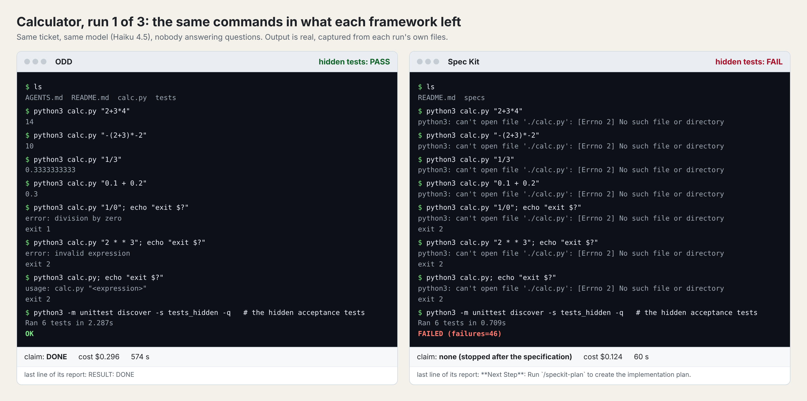

# 19. A calculator, built with odd and with Spec Kit

*Written 2026-11-18. One small task, three runs per framework, one model: a hint, not a rate. The owner asked for a
head-to-head on a calculator with Haiku 4.5 and an LLM judge to decide. Data: [data/calculator/](data/calculator/).*

## Answer

**The judge chose odd.** It did not know which framework was which (they were labelled A and B, with each
framework's own folders removed from the code).

| | odd | Spec Kit |
|---|---|---|
| working calculators (hidden tests all pass) | **3 of 3** | 1 of 3 |
| false DONE | 0 | 0 |
| cost, all three runs | **$0.68** ($0.16 to $0.30 a run) | $1.42 ($0.12, $0.15 and $1.14) |
| time a run | 76 s, 89 s, 574 s | 60 s, 66 s (no code), 394 s (the one that delivered) |

What this supports: on this calculator task with Haiku 4.5, odd delivered in every run and Spec Kit in one of three,
and odd's cost for each working calculator was about a fifth of Spec Kit's ($0.23 against $1.14 for its one delivery;
$1.42 counting the two runs that delivered nothing). It does not support a general ranking: one task, three runs,
one model.

## The task

One ticket, the same for both ([ticket.md](data/calculator/ticket.md)): `python3 calc.py "<expression>"` with
`+ - * /`, precedence, parentheses, repeated unary signs, exact output formatting, three kinds of error with fixed
messages and exit codes, no `eval` or `exec`, and its own unit tests. Graded by hidden tests neither framework saw
([hidden_tests.py](data/calculator/hidden_tests.py)): 25 expressions, 3 divisions by zero, 15 invalid inputs, the
usage message, the no-eval rule, and that the project's own tests pass. The hidden tests fail on the empty project
and pass on a reference solution written to check them.

Both arms are the harness's own (`bench/arms/odd`, `bench/arms/speckit`: Spec Kit 1.4.0 with its documented
six-step process named in the prompt), run with `--model claude-haiku-4-5 --max-turns 150 --timeout 1800`, harness
at commit c17e961; every session was served by `claude-haiku-4-5`. Nobody answered questions.

## The six runs, side by side

Each image shows the same commands run in what the run left behind; the output is real.

## Why the judge chose odd

The ruling in full: [judge-ruling.md](data/calculator/judge-ruling.md). Its reasons, in the order it weighed them:

1. **Delivery.** odd left a working calculator in 3 of 3 runs. Two of Spec Kit's three runs ended after writing the
   specification ("Next Step: Run `/speckit-plan`"), with no code and no claim, although the prompt told it to carry
   on through every step. Both failures were the same failure, which points to a cause rather than chance.
2. **Honesty: a tie.** Neither framework claimed DONE falsely. Spec Kit's two non-deliveries made no claim at all.
3. **Quality of what was left.** Spec Kit's one delivery was on a par with odd's and had the widest tests (82, split
   by behaviour, against 36 to 45) and the cleanest structure (a separate evaluator). odd's third calculator was the
   weakest delivered: `.` alone prints `0`, and `1/0+` reports division by zero where the ticket says invalid
   expression; the hidden tests cover neither. All four delivered calculators share gaps the ticket's examples do
   not reach (very small results print in scientific notation).
4. **Cost and time.** odd spent $0.68 for three calculators; Spec Kit $1.42 for one.

The judge's own confidence: high on the direction, moderate on the size of the gap.

## What to keep in mind

- **Three runs each, one task, one model.** 3 of 3 against 1 of 3 is not statistically significant.
- **One odd run was flagged** by the harness's contamination rule: a process listing in its transcript showed the
  harness's own launch command. No solution was reachable from it, and the judge's ruling is the same with that run
  left out (2 of 2 against 1 of 3).
- **Spec Kit's stops may be a property of this pairing**, a step-by-step process with a small model and nobody to say
  "continue", rather than of Spec Kit with a stronger model or a person present. The earlier comparison ([15](15-comparison.md)) measured Spec Kit at
  2 to 5 times a plain agent's cost.
- **odd's own check is not what made the difference here**: nothing claimed done falsely in either arm. The
  difference was that one process finished and the other stopped.
- The whole comparison cost $2.10.
